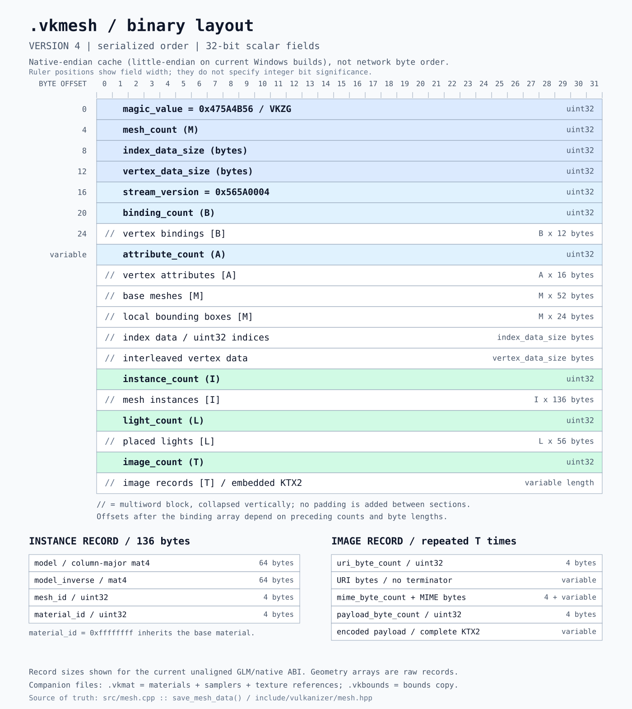

# Vulkanizer

> **Under development:** You are welcome to use this project, but it is not fully documented yet. Expect to explore the source code and examples and work out the integration yourself.

Vulkanizer is a small C++20 helper library for building Vulkan applications. It wraps common setup and rendering tasks while keeping the underlying Vulkan handles and commands accessible.

The library currently provides:

- Vulkan instance, device, surface, queue, and swapchain setup
- Owning and non-owning Vulkan contexts
- A reusable GLFW-based `vulkan_app`
- Spectator, first-person, and orbit camera controllers
- A standalone GLFW input adaptor with combined keyboard, mouse, and gamepad input
- Graphics, compute, and ray-tracing pipeline builders
- Owning ray-tracing pipelines with named shader binding tables and per-record payloads
- In-process inline GLSL compilation through glslang
- Core glTF graphics and single-hit ray tracing reference pipelines via `vulkanizer/reference.hpp`, with shared shading, optional IBL and cmrc-embedded shaders
- Dynamic rendering and synchronization helpers
- Command pools, scoped command buffers, ring fences, and batched queue submission
- Vulkan Memory Allocator-backed buffers and images with explicit cleanup and non-owning allocator support
- Reusable staging-buffer memory with aligned borrowing, GPU transfer helpers, and explicit range returns
- Descriptor-pool creation, allocation, freeing, resetting, and explicit cleanup
- Descriptor, primitive, transform, CSM, and Dear ImGui utilities
- Portable temporal anti-aliasing with camera motion, history rejection and configurable reconstruction filters
- Software-paged sparse virtual shadow maps with GPU bounds culling, integer depth atomics, caching, and indirect draw integration

## Documentation

- [Buffers, images, image views, samplers and textures](docs/resources.md): creation, upload, flags and cleanup
- [Pipeline builders](docs/pipelines.md): graphics, compute, ray tracing and nested state configuration
- [Builder index](docs/builders.md): context, swapchain, descriptor-set layouts and resource/pipeline entry points
- [Application setup](docs/application.md): the GLFW application layer

See [ray-tracing pipelines and the Stanford Bunny SBT demo](docs/ray_tracing.md) for the builder DSL and test executable. The [mesh reference integration guide](docs/reference_ray_tracing.md) covers the glTF pipelines, IOR/transmission with up to eight secondary bounces, and optional environment lighting. `vulkanizer/ibl.hpp` generates environment, irradiance and specular cubemaps from HDR images; IORTestGrid enables it by default (`--no-ibl` disables it).

## Mesh file layout

The `.vkmesh` v4 cache stores geometry, instances, placed lights, and embedded
KTX2 images in the order shown below. The diagram uses TCP/IP-style field rows;
the file itself uses native byte order, not network byte order. Variable-length
blocks are collapsed, and record sizes reflect the current native ABI.



See [mesh format documentation](docs/mesh.md#storage) for details and the
`.vkmat` and `.vkbounds` companion files.

## Requirements

- CMake 3.24 or newer
- A C++20 compiler
- Vulkan SDK, including `glslc` to embed the TAA shaders
- Conan 2

The Conan recipe supplies Volk, GLFW, Dear ImGui, GLM, and Vulkan Memory Allocator.

## TODO

- Use indexed indirect drawing in the reference raster renderer instead of one draw per mesh instance. Batch compatible pipeline/material state, preserve transparent draw ordering, and profile CPU submission and GPU time separately.
- Complete the Nsight Aftermath shader-debug integration: assign stable debug names to shader modules and pipelines, retain/register shader binaries and debug information, and provide the lookup callbacks needed to resolve crash-dump shader hashes to shader names and source lines instead of generic labels such as `fragment_01`.

## Build

Install the dependencies and generate the Conan toolchain:

```powershell
conan install . --output-folder=build --build=missing -s build_type=Release
```

Configure and build with the generated preset:

```powershell
cmake --preset conan-default
cmake --build --preset conan-release
```

Tests are enabled by default. Disable them for a library-only build:

```powershell
cmake --preset conan-default -DVULKANIZER_BUILD_TESTS=OFF
```

To create the Conan package locally:

```powershell
conan create . --build=missing
```

This repository currently produces `vulkanizer/1.1.0`. See [release notes](CHANGELOG.md).

### CLion Debug and Release build directories

Each build directory needs its own Conan dependencies. Run both installs after
changing `conanfile.py` (for example, when adding TinyGLTF), then configure and
build both configurations:

```powershell
conan install . --output-folder=cmake-build-debug --build=missing -s build_type=Debug
conan install . --output-folder=cmake-build-release --build=missing -s build_type=Release
cmake -S . -B cmake-build-debug -G "Visual Studio 17 2022" -DVULKANIZER_BUILD_TESTS=ON
cmake -S . -B cmake-build-release -G "Visual Studio 17 2022" -DVULKANIZER_BUILD_TESTS=ON
cmake --build cmake-build-debug --config Debug --parallel 4
cmake --build cmake-build-release --config Release --parallel 4
```

CMake discovers the generated packages under each directory's `build/generators`.

## Use from CMake

After making the package available to Conan, add it to your consuming recipe and link the exported target:

```cmake
find_package(vulkanizer CONFIG REQUIRED)

target_link_libraries(my_app PRIVATE vulkanizer::vulkanizer)
target_compile_features(my_app PRIVATE cxx_std_20)
```

A minimal application can use the library-owned GLFW/Vulkan bootstrap:

```cpp
#include <vulkanizer/vulkan_app.hpp>

int main() {
    vkz::vulkan_app app{{
        .width = 1280,
        .height = 720,
        .title = "My Vulkan app",
    }};

    auto swapchain = app.create_swapchain();

    while (!app.should_close()) {
        app.poll_events();
        // Acquire, render, and present.
    }
}
```

## Camera input

The GLFW input adaptor is provided by its own header. Create it for the application window, bind it, and pass its source-agnostic input device to a camera controller:

```cpp
#include <vulkanizer/glfw_input_adaptor.hpp>

vkz::glfw_input_adaptor input(app.window());
input.bind();

vkz::camera::camera camera;
vkz::camera::controller controller{
    camera,
    vkz::camera::movement_type::spectator,
    input.get_device(),
};

// Once per frame:
input.process_game_pad_input();
controller.process_input();
controller.update(delta_seconds);
```

Keyboard and gamepad state are merged, so either source can remain active without an idle source cancelling it. When multiple sources hold the same direction, the strongest input speed is used.

Default controls are:

| Input | Action |
|---|---|
| `W` / `S` | Forward / backward |
| `A` / `D` | Left / right |
| `Q` / `E` | Down / up |
| Left mouse drag | Look around |
| Mouse wheel | Zoom |
| D-pad or left stick | Move horizontally |
| Left / right trigger | Down / up |
| Right stick | Look around |

Construct the controller with `movement_type::spectator` for free-flight movement or `movement_type::first_person` for movement constrained relative to world up.

Use `movement_type::orbit` to rotate around `camera.target` with left mouse drag and change the distance with the mouse wheel. Orbit zoom is bounded by `camera.minZoom` and `camera.maxZoom` and leaves the field of view unchanged.

## CPU profiling

`vkz::profiler` can measure CPU scopes without initializing Vulkan:

```cpp
#include <vulkanizer/profiler.hpp>

vkz::profiler timings;
timings.add_cpu_query("update");
timings.profile_cpu("update", [&] {
    update_scene();
});
const auto milliseconds = timings.cpu_query_stats().at("update").mean;
```

CPU scopes measure monotonic elapsed wall time, including waits. Each successful
call records a sample and updates its average immediately; no `commit()` or
`end_frame()` call is required. Exceptions propagate without recording a sample.
`paused` skips measurement while still running the body. CPU and GPU queries have
separate names and statistics, so the same label can be used for both.
Raw samples and averages in `cpu_queries` are nanoseconds; statistics are
milliseconds (variance is milliseconds squared). `clear_cpu(name)` resets an
average, and `clear_runtimes()` clears both CPU and GPU sample histories.
CPU queries survive GPU `init()`/`deinit()`. Access to a profiler must be externally
synchronized; use separate instances for concurrent threads.

## Examples

The executables under `test/` are interactive examples:

- `vulkanizer_context_test` - application, swapchain, and Dear ImGui setup
- `vulkanizer_primitive_test` - generated primitive rendering
- `vulkanizer_csm_test` - cascaded shadow mapping
- `vulkanizer_camera_test` - camera input, movement switching, cubemap skybox, and an infinite checkerboard floor

On a Visual Studio Debug build, the camera example can be run with:

```powershell
.\cmake-build-debug\test\Debug\vulkanizer_camera_test.exe
```

## License

MIT

## Temporal anti-aliasing

Include `<vulkanizer/taa.hpp>`. Like CSM, TAA uses a handle and free functions;
`vkz::taa::camera` contains only an unjittered view-projection matrix and a pixel
jitter offset, with no dependency on Vulkanizer's camera controllers.

```cpp
auto taa = vkz::taa::create({
    .device = device,
    .memory_allocator = allocator,
    .color = hdr_color,
    .depth = scene_depth,
    .in_flight_frames = frames_in_flight,
});

// Before drawing the scene:
const auto offset = vkz::taa::jitter(frame);
const auto raster_projection = vkz::taa::jitter_projection(projection, offset, extent);
vkz::taa::update(taa, {.view_projection = projection * view, .jitter = offset}, frame);

// After the scene and before tone mapping/UI, outside a render pass:
// Transition/synchronize the inputs to the readable layouts supplied at creation.
vkz::taa::resolve(taa, command_buffer);
```

Color and depth are borrowed, single-sample 2D textures with matching extents.
Color must be RGBA16F or RGBA32F with sampled and transfer-destination usage;
depth needs sampled usage. A color texture containing Vulkan [0,1] depth is also
accepted; select its channel with `params::depth_channel`. Reverse-Z is not
supported. Render every current-frame pixel; sparse Bayer cloud reconstruction
requires a separate validity mask and is not provided by this resolve.

The resolve writes back into the supplied color image and restores its layout.
It owns its descriptors, samplers, camera uniforms, motion vectors and history.
Shaders are embedded at build time, so applications need no runtime shader paths
or bindless texture registry. Submit updates/resolves once per frame on a single
graphics/compute queue that supports transfer operations.

`configure` changes filtering and resets history. Use `reset` for camera cuts or
scene changes. After finishing outstanding GPU work, use `resize` with replacement
inputs or `destroy` to release the instance. Moving objects and animated cloud
motion currently use camera-only reprojection; object motion vectors are not
part of this API. `motion_vectors` returns a borrowed diagnostic texture in
GENERAL layout (XY UV displacement, Z previous depth, W validity).

## Sparse virtual shadow maps

Include `<vulkanizer/svsm.hpp>`. See [the SVSM integration guide](docs/svsm.md)
for the bounds ABI, shader integration, cache invalidation, synchronization, and
the tinyobjloader Bistro viewer. Build `vulkanizer_svsm_test` for GPU regression
coverage or `vulkanizer_svsm_bistro` for the interactive scene. Large Bistro and
Vista skybox assets are local test resources and are not included in Git.

`vulkanizer_glass_vase_flowers_test` exercises volume refraction with the orbit camera and shared IBL. Use `--ray-traced` to select ray tracing; the default uses graphics with ray queries. Both support Beer absorption and retain the eight-secondary-bounce limit.


The reference pipelines support texture transforms, punctual lights, specular, emissive strength, unlit, clearcoat, sheen, anisotropy, iridescence and dispersion. Run `vulkanizer_material_extensions_test --scene ClearCoatTest` or add `--ray-traced` to compare the paths. See [extension integration and sample scenes](docs/reference_ray_tracing.md#material-extensions) for the material/light ABI and available scenes.

Use the [sample model scripts](test/mesh/scripts/README.md) to convert missing Khronos sample assets and render any converted model with the reference test.

## Video decode

Include `<vulkanizer/video.hpp>` for MP4/H.264 Vulkan Video decode. Build
`vulkanizer_video_test` to play the original video_playback clips with an ImGui
clip selector, pause, restart and seek controls. See [video integration and frame
verification](docs/video.md) for device requirements, sample assets and test commands.
Use `vulkanizer_video_test --video-path <file.mp4>` to add/select a custom video.
Embedded audio uses [Vulkanizer's port of Vista's audio engine](docs/audio.md).
