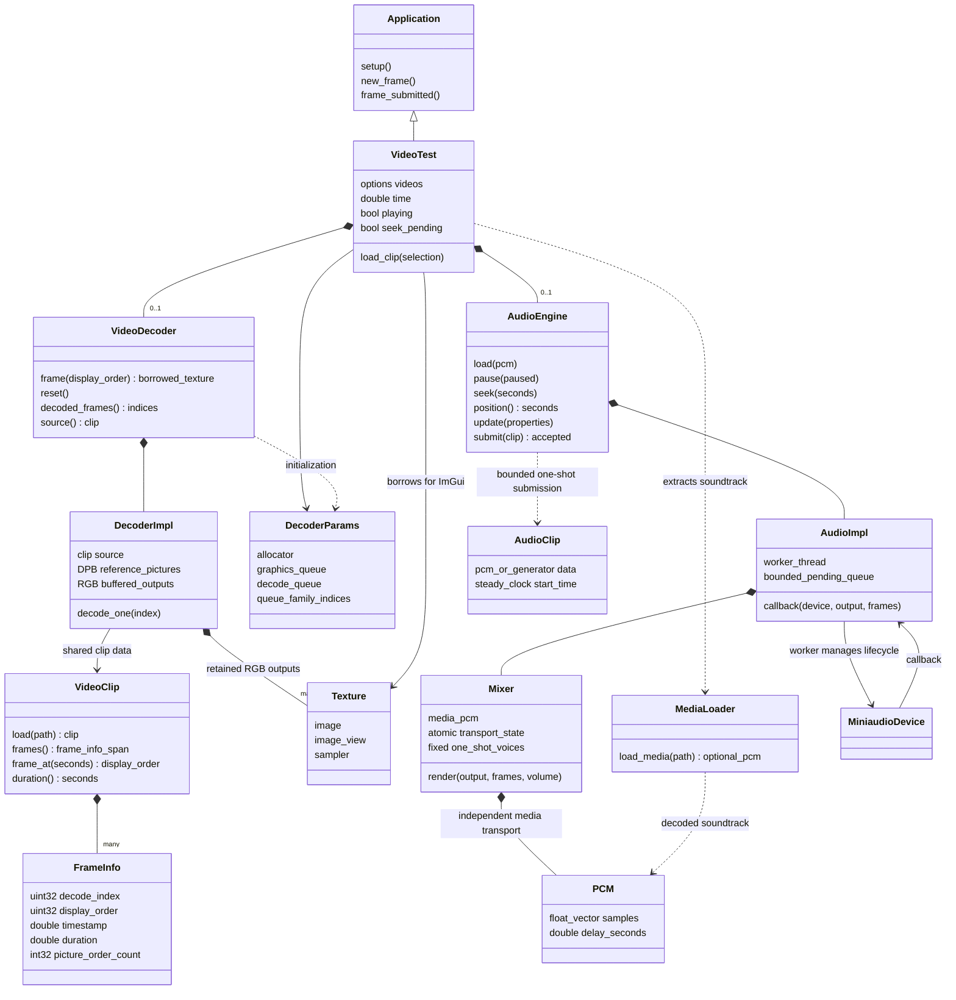

# Video and audio integration

These diagrams describe `test/video.cpp`, `video.hpp`, `src/video.cpp` and the
audio module. Short class names represent the namespace-qualified C++ types.

## Classes and ownership



`VideoClip`, `VideoDecoder`, and `AudioEngine` are `vkz::video::clip`,
`vkz::video::decoder`, and `vkz::audio::engine`. `MediaLoader` represents the free
function `vkz::audio::load_media`, not a C++ class. The decoder owns RGB textures;
the player borrows them. Finish previous draws before requesting another frame
or resetting the decoder.

## Selecting a clip and preparing its soundtrack

```mermaid
sequenceDiagram
    actor User
    participant Player as video_test / main thread
    participant Clip as video::clip
    participant Decoder as video::decoder
    participant Loader as audio::load_media
    participant MF as Media Foundation
    participant Engine as audio::engine
    participant Worker as audio worker
    participant Device as miniaudio device
    participant Mixer as audio mixer
    User->>Player: --video-path file or ImGui selection
    Note over Player: CLI adds/deduplicates paths; last supplied path is selected.<br/>ImGui selection is deferred to a safe new_frame().
    opt Existing audio engine
        Player->>Engine: pause(true)
    end
    Player->>Player: remove descriptors; destroy old decoder
    Player->>Clip: load(path)
    Clip-->>Player: MP4/H.264 data and presentation timeline
    Player->>Decoder: construct(params, clip); frame(0)
    Decoder-->>Player: borrowed first RGB texture
    opt Audio enabled and not fast --verify
        Player->>Loader: load_media(path)
        Loader->>MF: decode timestamped float PCM
        MF-->>Loader: audio samples
        Loader->>Loader: apply MP4 track edits; preserve gaps<br/>resample/downmix to 48 kHz stereo
        Loader-->>Player: optional PCM
        opt Soundtrack present
            Player->>Engine: create lazily; load(move(pcm))
            Engine->>Worker: queue media request; wait
            Worker->>Device: stop callbacks
            Worker->>Mixer: replace media; position=0; paused=true
            Worker->>Device: restart callbacks
            Worker-->>Engine: request complete
            Engine-->>Player: media prepared and paused
            Player->>Engine: update(volume)
        end
    end
    Player->>Player: reset playback time and frame tracking
    Player->>Player: submit first video draw
    opt Soundtrack present
        Player->>Engine: frame_submitted(): pause(!playing)
    end
```

Interactive playback uses the default audio output. `--verify-playback` uses
the null device. Without a soundtrack, the player uses a steady clock.

## Playback and GPU decode

```mermaid
sequenceDiagram
    participant App as application / main thread
    participant Player as video_test
    participant Engine as audio::engine
    participant Clip as video::clip
    participant Decoder as video::decoder
    participant DecodeQ as Vulkan decode queue
    participant GraphicsQ as Vulkan graphics/compute queue
    participant UI as ImGui
    App->>App: wait frame-slot fence
    App->>Player: new_frame()
    opt Playing with audio
        Player->>Engine: position()
        Engine-->>Player: callback sample position / 48000
        Player->>Player: interpolate time; correct phase over 100 ms<br/>bound to audio clock +/- half shortest frame
    end
    Player->>Clip: frame_at(playback time)
    Clip-->>Player: display order
    Player->>Decoder: frame(display order)
    opt Requested RGB picture is not buffered
        loop Decode order until requested display order is available
            Decoder->>DecodeQ: begin coding; decode H.264 with DPB references; end coding
            DecodeQ-->>GraphicsQ: decoded semaphore
            Decoder->>GraphicsQ: barriers and compute YCbCr-to-RGB resolve
            GraphicsQ-->>DecodeQ: resolved semaphore for next decode
            Decoder->>GraphicsQ: wait_idle()
            Decoder->>Decoder: retain RGB by display order; update references
        end
    end
    Decoder-->>Player: borrowed RGB texture
    Player->>UI: register/reuse descriptor; Image(texture)
    App->>GraphicsQ: submit rendered frame
    App->>Player: frame_submitted()
    Player->>Player: track render/display indices, hold time and A/V drift
    Note over Player: At video EOF, new_frame() pauses audio and stops playback.<br/>Looping is disabled.
```

B-frames have different decode and display orders. RGB outputs are retained
independently of DPB references. Repeated render indices between video timestamps
are expected when rendering faster than the source video.

## Audio worker and callback

```mermaid
sequenceDiagram
    participant Caller as caller thread
    participant Engine as audio::engine
    participant Worker as audio worker
    participant Ready as bounded ready queue
    participant Callback as miniaudio callback thread
    participant Mixer as audio mixer
    Caller->>Engine: submit(owned PCM or deferred generator)
    alt Pending capacity available
        Engine-->>Caller: true; ownership accepted
        Engine->>Worker: wake bounded pending queue
        opt Deferred generator
            Worker->>Worker: invoke generator
        end
        Worker->>Ready: publish prepared one-shot clip
    else Full or busy
        Engine-->>Caller: false; caller retains clip
    end
    Caller->>Engine: pause / seek / update volume
    Engine->>Mixer: publish atomic transport state
    loop Each audio block
        Callback->>Mixer: render(output, frames, volume)
        Mixer->>Mixer: apply pending seek; clear output
        opt Media is playing
            Mixer->>Mixer: copy media PCM; advance sample clock<br/>continue clock through silence after audio EOF
        end
        Mixer->>Ready: consume prepared one-shot clips
        Mixer->>Mixer: mix fixed voices; smooth gain; clamp output
        Mixer-->>Callback: stereo float block
        Mixer->>Worker: publish retired one-shot storage
        Worker->>Worker: reclaim retired clips
    end
    Note over Callback,Mixer: Callback performs no allocation, freeing, locks,<br/>logging, or deferred generator execution.
```

Media transport is separate from the bounded one-shot voice pool. Media is
predecoded into memory without a fixed duration limit. `position()` is a sample clock; it does not
measure additional hardware output latency.

## Seeking and resuming

```mermaid
sequenceDiagram
    actor User
    participant Player as video_test
    participant Engine as audio::engine
    participant Decoder as video::decoder
    participant App as application
    User->>Player: drag position slider
    Player->>Player: set playback time; seek_pending=true
    Player->>Engine: pause(true); seek(time), if audio present
    App->>Player: next new_frame() after frame-slot fence
    Note over Player: Playback time does not advance while seek is pending.
    Player->>Decoder: frame(clip.frame_at(time))
    opt Backward seek
        Decoder->>Decoder: reset references and buffered outputs<br/>decode again from initial IDR
    end
    Decoder-->>Player: sought RGB texture
    Player->>App: render sought frame
    App->>Player: frame_submitted()
    Player->>Player: clear seek_pending
    Player->>Engine: pause(!playing), if audio present
    Note over Player,Engine: Resume only if previously playing.<br/>Restart reloads the selected clip using the preparation sequence.
```
